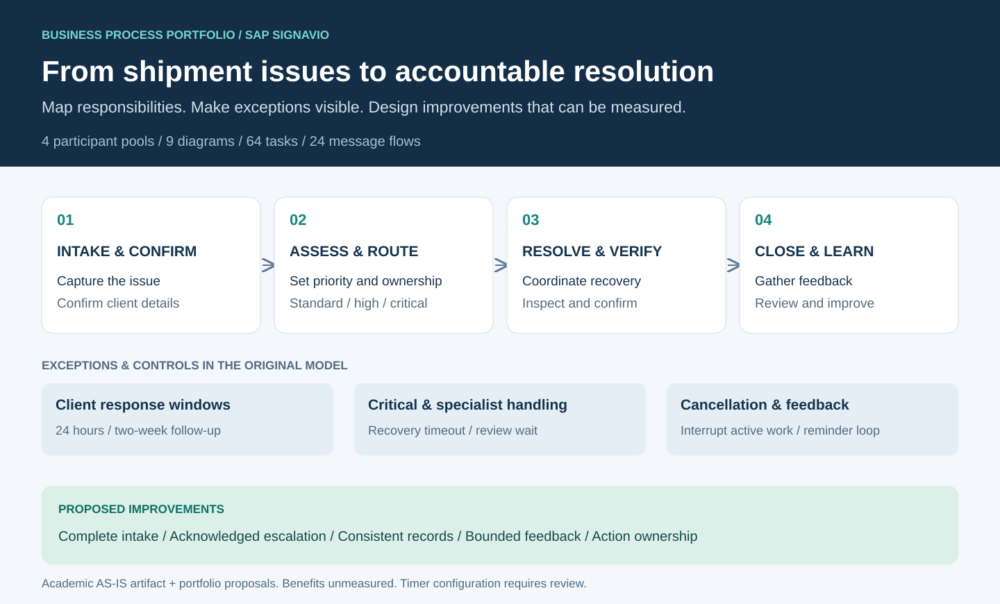

# SwiftCargo Shipment Issue Resolution

**Business Process Analysis · Process Improvement · SAP Signavio · BPMN 2.0**

A business process portfolio showing how I translate a complex logistics case into a reviewable process model: who owns each step, how work moves between teams, which events trigger escalation, and how customer feedback feeds into process review.

The original **SAP Signavio AS-IS model** is the foundation. A separate improvement case adds prioritised recommendations, acceptance criteria and a measurement plan. The recommendations are portfolio extensions, with benefits to be tested in a pilot.

**[View the process](docs/model-gallery.md) · [Improvement case](docs/improvement-case.md) · [SAP Signavio evidence](docs/signavio.md) · [Download BPMN](models/swiftcargo-as-is.bpmn) · [繁體中文](README.zh-TW.md)**



## What this project demonstrates

| Capability | Application in this case | Evidence |
| --- | --- | --- |
| Turn a narrative into a business process | Define the case lifecycle, decision points, responsibilities and external participants | [Original BPMN model](models/swiftcargo-as-is.bpmn) and [model gallery](docs/model-gallery.md) |
| Model cross-functional work | Separate internal roles from the client, recovery partner and loss adjuster | Four participant pools; nested lanes; 24 message flows |
| Represent deadlines and exceptions | Client response windows, critical recovery timeout, third-party review, cancellation and reminders | Timer, message, boundary and event-based constructs in the source model |
| Work with SAP Signavio | Build and decompose a BPMN model; retain diagram layout and export BPMN 2.0 XML | Signavio exporter metadata and nine diagram definitions; [tool evidence](docs/signavio.md) |
| Identify improvement opportunities | Examine waiting, repeated data updates, hand-offs and feedback dependency | [Five prioritised proposals](docs/improvement-case.md) |
| Make improvement measurable | Define cycle time, deadline compliance, rework and customer feedback metrics | [KPI definitions and pilot plan](docs/measurement-plan.md) |
| Review the model critically | Record static findings, assumptions and evidence limits | [Model review](docs/model-review.md) and [reproducible inventory](docs/evidence/model-inventory.json) |

## Business problem

SwiftCargo is a fictional logistics organisation in a University of Queensland BISM7216 case. Shipment issues can involve damage, delay, loss or misrouting. The process must coordinate customer communication, claims assessment, recovery, quality inspection and management oversight.

The modelling challenge is to make both routine work and exceptions visible without losing accountability. Critical cases require a different recovery path from standard cases; high-priority cases may require specialist advice; customers can cancel during assessment or resolution.

## The original implementation

The supplied file is a native **BPMN 2.0 XML export from Signavio Process Editor**. It is preserved byte for byte under a descriptive filename.

| Source-model inventory | Count |
| --- | ---: |
| Participant pools | 4 |
| Diagrams | 9 |
| Tasks | 64 |
| Regular sub-processes | 8 |
| Ad-hoc sub-processes | 1 |
| Sequence flows | 155 |
| Message flows | 24 |
| Event-based gateways | 4 |
| Timer definitions / boundary events | 6 / 2 |

Counts describe the file, not a quality score. One reminder message flow has no endpoints and is omitted by the preview renderer; timer configuration and layout also need review. The [review notes](docs/model-review.md) document these findings. The source model is retained as the historical AS-IS artifact rather than silently revised to match the teaching solution.


This preview is generated from the original BPMN layout. [Explore all nine diagrams](docs/model-gallery.md).

## From process visibility to improvement

| Observation in the case/model | Proposed response | Measure to evaluate |
| --- | --- | --- |
| Client confirmation can move into an idle period | Structured intake, an explicit owner and visibility of waiting cases | Time awaiting client; intake completeness |
| Recovery depends on time-sensitive hand-offs | Due dates, advance alerts and acknowledged escalation | Deadline compliance; escalation acknowledgement time |
| Case records and issue logs are updated in several places | Capture a case change once and synchronise the related views | Update effort; conflicting-record rate |
| Close-out waits for client feedback and repeats reminders | Separate operational closure from feedback collection, with a controlled follow-up policy | Closure-to-review lag; feedback response rate |
| Monthly review collects improvement ideas | Assign action owners and review results against a baseline | Action completion rate; repeat-issue rate |

These are hypotheses for a redesign. No operational event log, cost baseline or pilot result was supplied, so the repository makes no claim of achieved savings, faster resolution or production deployment.

## Review or reuse the model

1. Start with the [diagram gallery](docs/model-gallery.md) and [modelling decisions](docs/modelling-decisions.md).
2. Download [swiftcargo-as-is.bpmn](models/swiftcargo-as-is.bpmn).
3. Import it into an authorised SAP Signavio workspace using the BPMN 2.0 XML import option. Inspect the main process and all sub-processes, then run the workspace's syntax and convention checks.
4. For a local structural inventory, use Python 3.10+ with its standard library:

```bash
git clone https://github.com/1121eason/UQxSwiftCargo-ProcessImprovement.git
cd UQxSwiftCargo-ProcessImprovement
python3 scripts/inspect_model.py --check
```

The script checks XML parsing, unique IDs, references, diagram coverage and inventory freshness. It reports the known missing flow endpoints and descriptive/missing timer expressions separately. `--check` passing means these limited integrity checks and the committed report agree; it does not mean the source has no modelling defects. It does not execute the process or replace Signavio validation.

## Repository map

| Path | Contents |
| --- | --- |
| `models/` | Unmodified source BPMN with a public-facing filename |
| `docs/assets/` | Process overview and generated model previews |
| `docs/model-gallery.md` | Diagram navigation and rendering provenance |
| `docs/improvement-case.md` | Business rationale, priorities, trade-offs and acceptance criteria |
| `docs/measurement-plan.md` | KPI definitions, event-data requirements and pilot design |
| `docs/signavio.md` | SAP Signavio evidence and reproduction guide |
| `docs/model-review.md` | Findings and limits of the current model |
| `docs/evidence/` | Source provenance and reproducible inspection output |
| `scripts/` | Standard-library model inspection |

**Author:** Yi Cheng Lee (Eason) · University of Queensland. Developed from an individual BISM7216 process-modelling assignment. Portfolio documentation, improvement proposals, inspection tooling and generated previews were prepared with AI assistance. The assignment brief and teaching solution remain local reference material. See [provenance](docs/evidence/README.md) and [usage notes](NOTICE.md).
