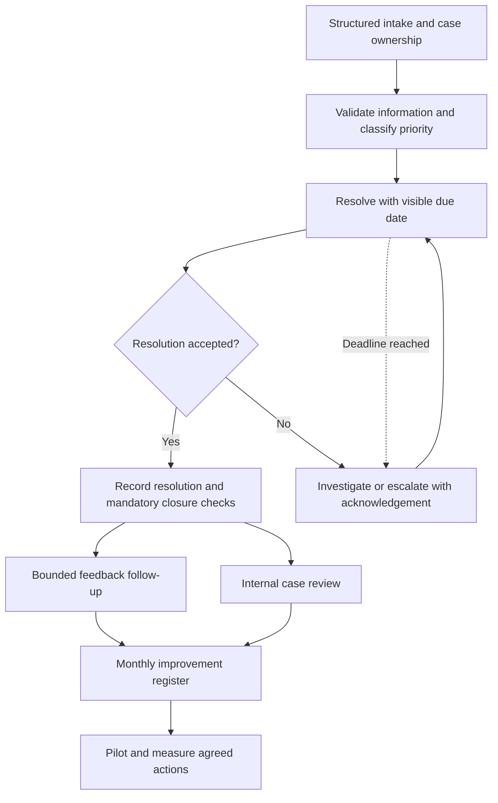

# Improvement case

## Decision to support

How can the shipment issue-resolution process reduce avoidable waiting and coordination effort while retaining escalation, customer communication and compliance controls?

The original assignment asked for an AS-IS model. The following recommendations are a **new portfolio analysis**, derived from the case and the supplied model. They have not been implemented in the original BPMN or evaluated against operational data. The ordering below is an initial assessment of dependencies and controllability, not a calculated return-on-investment ranking.

## 1. Make intake complete and owned

**Observed basis:** `Confirm issue details` waits for a change request, confirmation or a 24-hour timeout. Idle cases then wait for information or a two-week deadline. The model makes the waiting visible but does not provide a structured completeness check.

**Proposal:** capture shipment identifier, issue type, business impact, contact details and supporting evidence in a structured case form. Assign a named owner and record why a case is waiting. Show incomplete cases in an owner-specific queue. Keep a staff-assisted route for phone and accessibility needs.

**Expected mechanism:** reduce clarification loops and make idle work visible. Faster resolution is a hypothesis until measured.

**Priority:** first pilot. **Business owner:** GM CE; Claims Manager operates the queue.

**Acceptance criteria:** each submitted case has a unique identifier and owner; missing mandatory fields are explicit; attachments can be added later; waiting reason and start time are recorded; duplicate or late messages are correlated to the existing case.

**Trade-off:** overlong forms can discourage reporting. Validate only what is needed to route the case, and review completion and abandonment together.

## 2. Make escalation an acknowledged hand-off

**Observed basis:** the source contains a three-day boundary timeout on critical recovery and a five-day wait for loss-adjuster advice. Most timers have descriptive labels without formal expressions. The case also specifies standard-case and external-partner timeframes.

**Proposal:** define a due-date policy for each priority and waiting state. Specify calendar versus working days, timezone, holidays, pause rules and the effect of a priority change. Alert the current owner before expiry; at expiry, create a uniquely identified escalation task requiring receiver acknowledgement. Record the receiving partner's contractual deadline independently.

**Expected mechanism:** reduce unowned overdue work and make deadline breaches diagnosable.

**Priority:** first pilot, following policy agreement. **Business owner:** Claims Manager and GM CE; partner terms require procurement/legal confirmation.

**Acceptance criteria:** every eligible case receives a reproducible due date; a timeout triggers exactly one escalation; late replies do not start a second resolution path; the previous owner remains accountable until acknowledgement; escalation and resolution timestamps are retained.

**Trade-off:** a shorter target can increase escalation volume without improving outcomes. Examine workload and safety/compliance quality alongside speed.

## 3. Capture a case change once

**Observed basis:** tasks repeatedly update the case record, issue log and MD dashboard across the standard, high and critical paths.

**Proposal:** agree a canonical case record and event history. Capture a status change once, then synchronise authorised views and partner messages. Add reconciliation, retry and manual exception handling before retiring any existing update step.

**Expected mechanism:** reduce repeated entry and inconsistent status. The case does not establish how the existing Logistics Management System stores data; integration feasibility must be assessed.

**Priority:** second phase after field and status definitions stabilise. **Business owner:** process owner with the system owner.

**Acceptance criteria:** repeated delivery of the same change does not duplicate records; failed synchronisation is visible; authorised staff can reconcile discrepancies; who changed what and when remains auditable.

**Trade-off:** synchronisation creates a dependency on system availability. Provide a controlled manual fallback with a reconciliation owner.

## 4. Separate operational closure from feedback follow-up

**Observed basis:** `Collect feedback and close out` waits for feedback, with a weekly reminder loop. The Claims Close-out Meeting follows feedback receipt. Non-response can therefore delay this close-out work indefinitely.

**Proposal:** distinguish `resolution completed`, `customer confirmation pending`, `feedback pending` and `administratively closed`. Agree a bounded reminder policy and a defined route for dissatisfied customers or reopening. Permit internal review after an agreed waiting threshold even when optional feedback is absent.

**Expected mechanism:** keep unresolved cases visible while avoiding an unbounded dependency on optional survey responses. This changes the original process and requires business approval.

**Priority:** first pilot as a controlled policy experiment. **Business owner:** GM CE with Claims Manager.

**Acceptance criteria:** operational resolution and administrative closure have separate timestamps; no mandatory confirmation/compliance obligation is bypassed; reminder limits are configurable; a late complaint can reopen the case with traceability; survey non-response is never recorded as satisfaction.

**Trade-off:** early administrative closure can hide unresolved dissatisfaction. Review reopened cases and complaints alongside close-out lag.

## 5. Turn monthly review into an improvement register

**Observed basis:** `Conduct monthly review` evaluates effectiveness, identifies improvements and incorporates feedback into future strategies.

**Proposal:** maintain an improvement register with issue category, evidence, action owner, due date, expected effect, baseline, review date and outcome. Review open actions and repeat issues at the monthly meeting. Preserve the link back to cases without exposing unnecessary customer details.

**Expected mechanism:** make review outcomes actionable and test whether changes reduce recurrence.

**Priority:** begin with the pilot and continue each month. **Business owner:** MD as sponsor; GM CE coordinates actions.

**Acceptance criteria:** each agreed action has one accountable owner, a review date and a defined outcome measure; completed actions include evidence; actions with no effect can be revised or stopped.

**Trade-off:** small case volumes and changing case mix can produce misleading comparisons. Segment by priority and issue type, and report counts and observation windows.

## Proposed target flow

This is a simplified **conceptual improvement sketch**, not a replacement BPMN model or an implemented TO-BE process.

The next design deliverable would be a reviewed TO-BE BPMN with cancellation, late-message handling, partner deadlines and feedback states fully modelled. A process owner should approve the policy changes before automation is considered.
