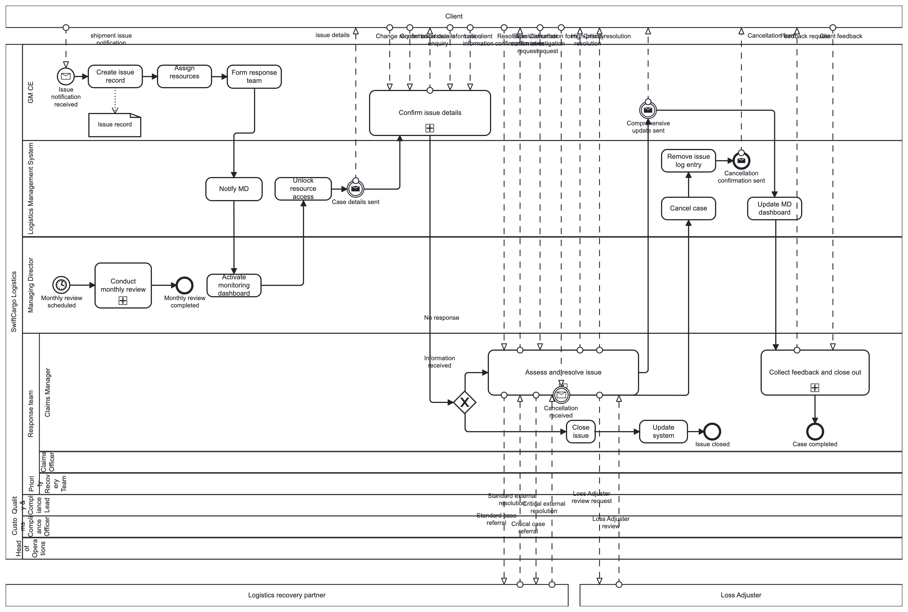
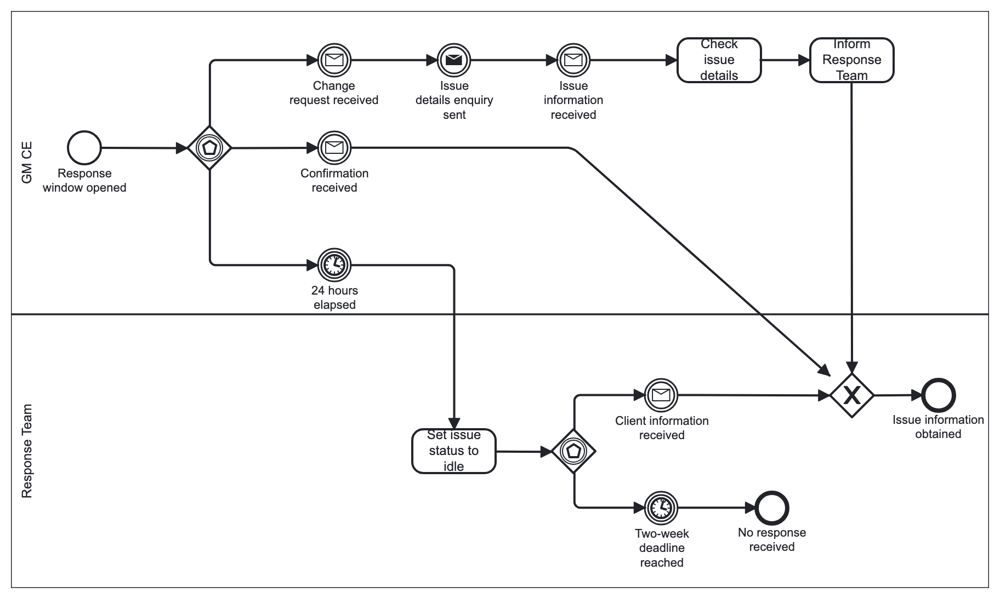
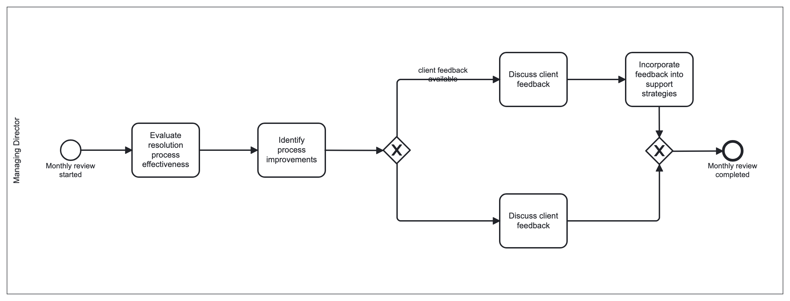
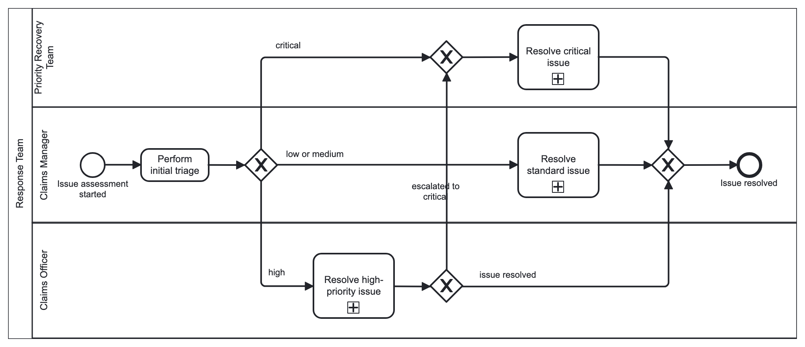
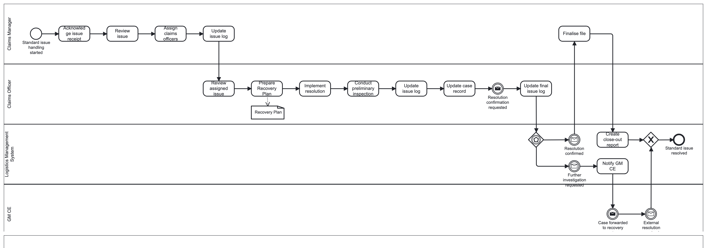
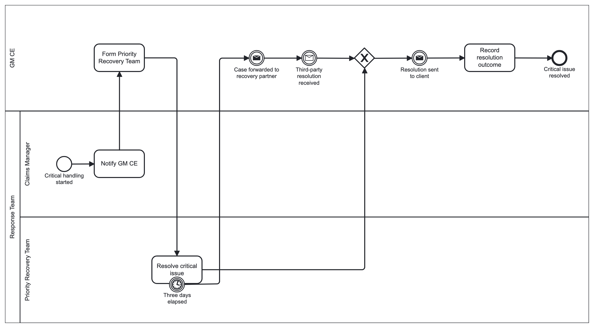
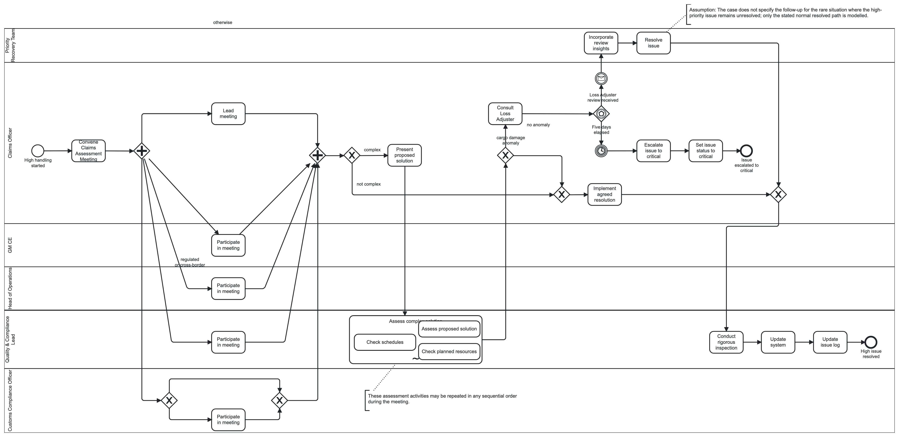
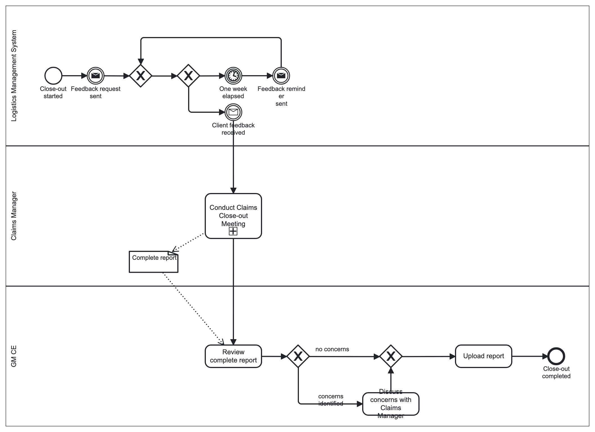
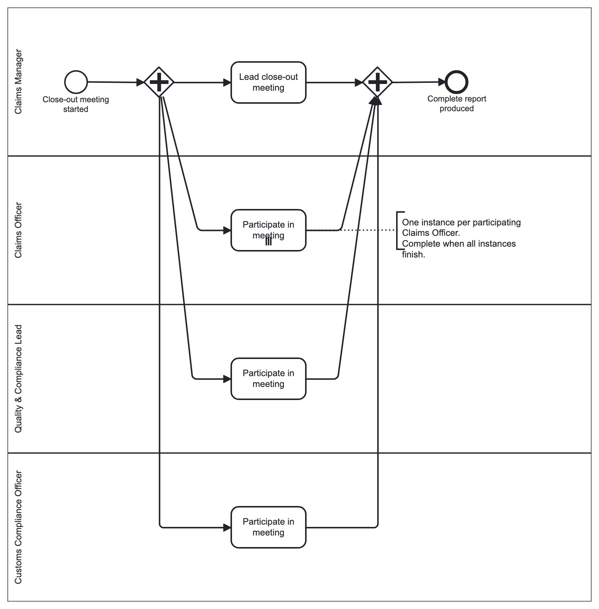

# Model gallery

The images below are generated from the preserved BPMN XML and its saved layout using **bpmn-js 18.9.1**. They are not screenshots or exports captured from a fresh Signavio session. Colour styling and label placement can differ from Signavio; the underlying source file is unchanged.

**[Download original BPMN](../models/swiftcargo-as-is.bpmn) · [Modelling decisions](modelling-decisions.md) · [Model review](model-review.md)**

One source message flow, `Feedback reminder`, has neither endpoint. The renderer reports this and omits that flow. Main-diagram labels and some lane/ad-hoc labels are crowded in the saved layout. These are disclosed review items rather than corrected historical evidence. See the [render report](evidence/render-report.json).

Use the PNG links for previews and SVG links to inspect at a larger scale. Read the diagrams together with the source model and the review notes.

| Diagram | PNG | SVG |
| --- | --- | --- |
| Main collaboration | [Preview](assets/01-main-collaboration.png) | [Vector](assets/01-main-collaboration.svg) |
| Confirm issue details | [Preview](assets/02-confirm-issue-details.png) | [Vector](assets/02-confirm-issue-details.svg) |
| Conduct monthly review | [Preview](assets/03-conduct-monthly-review.png) | [Vector](assets/03-conduct-monthly-review.svg) |
| Assess and resolve issue | [Preview](assets/04-assess-and-resolve-issue.png) | [Vector](assets/04-assess-and-resolve-issue.svg) |
| Resolve standard issue | [Preview](assets/05-resolve-standard-issue.png) | [Vector](assets/05-resolve-standard-issue.svg) |
| Resolve critical issue | [Preview](assets/06-resolve-critical-issue.png) | [Vector](assets/06-resolve-critical-issue.svg) |
| Resolve high-priority issue | [Preview](assets/07-resolve-high-priority-issue.png) | [Vector](assets/07-resolve-high-priority-issue.svg) |
| Collect feedback and close out | [Preview](assets/08-collect-feedback-and-close-out.png) | [Vector](assets/08-collect-feedback-and-close-out.svg) |
| Conduct Claims Close-out Meeting | [Preview](assets/09-conduct-claims-close-out-meeting.png) | [Vector](assets/09-conduct-claims-close-out-meeting.svg) |

## Main collaboration

[Open SVG at full scale](assets/01-main-collaboration.svg)

## Confirm issue details

[Open SVG at full scale](assets/02-confirm-issue-details.svg)

## Conduct monthly review

[Open SVG at full scale](assets/03-conduct-monthly-review.svg)

## Assess and resolve issue

[Open SVG at full scale](assets/04-assess-and-resolve-issue.svg)

## Resolve standard issue

[Open SVG at full scale](assets/05-resolve-standard-issue.svg)

## Resolve critical issue

[Open SVG at full scale](assets/06-resolve-critical-issue.svg)

## Resolve high-priority issue

[Open SVG at full scale](assets/07-resolve-high-priority-issue.svg)

## Collect feedback and close out

[Open SVG at full scale](assets/08-collect-feedback-and-close-out.svg)

## Conduct Claims Close-out Meeting

[Open SVG at full scale](assets/09-conduct-claims-close-out-meeting.svg)
